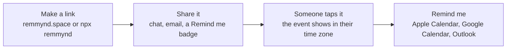

<p align="center">
  <a href="https://remmynd.space">
    <picture>
      <source media="(prefers-color-scheme: dark)" srcset="brand/logo/remmynd-logo-white.svg">
      
    </picture>
  </a>
</p>

<p align="center"><strong>Reminders, as a link.</strong><br>
Type what and when. Share the link. Anyone who taps it saves it to their calendar in one tap.</p>

<p align="center">
  <a href="https://www.npmjs.com/package/remmynd"></a>
  <a href="https://github.com/Remmynd/remmynd/actions/workflows/ci.yml"></a>
  <a href="https://github.com/Remmynd/remmynd/actions/workflows/deploy.yml"></a>
  
  <a href="LICENSE"></a>
</p>

<p align="center">
  <a href="https://remmynd.space"><strong>remmynd.space</strong></a> ·
  <a href="docs/PRINCIPLES.md">Principles</a> ·
  <a href="docs/ARCHITECTURE.md">Architecture</a> ·
  <a href="CHANGELOG.md">Changelog</a>
</p>

<p align="center">
  <a href="https://remmynd.space"></a>
</p>

---

## Why

Most "add to calendar" tools want an account, a dashboard and your visitors' data. remmynd wants none of that.

- **No sign-up**, for you or for the people you share with.
- **Nothing stored.** The whole reminder lives in the link, after the `#`. Browsers never send that part to a server, so remmynd.space cannot see what anyone is reminded about.
- **One tap to save.** "Remind me" picks the right calendar for the device: Apple Calendar on iPhone, iPad and Mac Safari, Google Calendar everywhere else. Outlook, Microsoft 365, the phone's share sheet (Reminders, Notes) and plain text are one tap away.
- **Sleep-safe.** If an event falls between 11 PM and 7 AM for a visitor, they can be reminded at 9 AM their time instead.
- **Free and open source** under the MIT licence. Host your own copy if you like.

## Use it

### On the web

Go to [remmynd.space](https://remmynd.space), fill in **what**, **when** and optionally **where**, then copy or share the link.

### Put a Remind me button on your site

[](https://remmynd.space/example)

```html
<a href="YOUR-REMMYND-LINK" target="_blank" rel="noopener">
  
</a>
```

Markdown:

```md
[](YOUR-REMMYND-LINK)
```

A dark version is at `https://remmynd.space/badge-dark.svg`.

### From the command line

```sh
npx remmynd "Demo day" --at "2026-12-05 18:00" --tz Asia/Kolkata --where https://lu.ma/demo
```

```text
Options
  --at, -a       When, e.g. "2026-12-05 18:00" (local to --tz) or an ISO time with Z
  --tz, -z       IANA time zone for --at (default: your system zone)
  --where, -w    A place or a link
  --notes, -n    One line of notes
  --host         Who is hosting
  --length, -l   Minutes (default 60)
  --ics [file]   Also write an .ics file ("-" prints it)
  --badge <fmt>  Print a Remind me badge snippet: html or md
  --dark         Use the dark badge
  --google       Also print a Google Calendar link
  --json         Print everything as JSON
  --base <url>   Use your own remmynd host

remmynd read <link>   Show what is inside a remmynd link
```

### In your code

```sh
npm install remmynd
```

```js
import { createLink, toICS, googleCalendarUrl, decode } from "remmynd";

const event = {
  title: "Demo day",
  start: "2026-12-05 18:00",
  timeZone: "Asia/Kolkata",
  location: "https://lu.ma/demo",
  durationMinutes: 90
};

createLink(event);         // https://remmynd.space/#eyJ0Ijoi...
toICS(event);              // .ics text with alerts 1 hour before and at the start
googleCalendarUrl(event);  // Google Calendar "add event" link
decode(link);              // { title, start: Date, durationMinutes, location, notes, host }
```

Zero dependencies. Works in Node 20+, Deno, Bun, Cloudflare Workers and browsers. Types included.

## How a link works

```text
https://remmynd.space/#eyJ0IjoiRGVtbyBkYXkiLCJzIjoiaHRxc3UifQ
                       └──────── base64url JSON ─────────┘
```

| Key | Meaning |
|---|---|
| `t` | Title |
| `s` | Start, in minutes since 1970 (UTC), base 36 |
| `d` | Length in minutes (omitted when 60) |
| `l` | Place or link |
| `n` | Notes |
| `h` | Host |

Times are stored in UTC and shown in each visitor's own time zone.

Saved events include the reminder link and a short "Made with remmynd.space" line in their notes. Nothing about the person saving the event is collected or added.



The full picture, including how requests are routed and how the `/ics` fallback works, is in [docs/ARCHITECTURE.md](docs/ARCHITECTURE.md).

## Privacy

- No database, no accounts, no cookies, no analytics.
- The site is static files served by Cloudflare. A tiny Worker (`worker/`) handles one route, `/ics`, used only by iPhone in-app browsers (Instagram, LinkedIn, Chrome on iOS), which ignore calendar files made inside the page. It builds the file from the link in memory and stores nothing.

## Self-host

remmynd runs on Cloudflare Workers: the files in `public/` are served as static assets, and `worker/index.js` handles `/ics`, the `www` redirect and named pages like `/example`.

```sh
git clone https://github.com/Remmynd/remmynd.git
cd remmynd
npx wrangler login
npm run ship      # runs the tests, then deploys
```

Change `name` and the `routes` in `wrangler.toml` to your own Worker name and domain first. To deploy on every push to `main`, add the `CLOUDFLARE_API_TOKEN` secret and `CLOUDFLARE_ACCOUNT_ID` variable to your fork; the included Deploy workflow does the rest ([details](docs/RELEASING.md#automatic-deploys)).

Any static host works for the site alone. Without the Worker, everything works except the iPhone in-app browser fallback.

## Develop

```sh
git clone https://github.com/Remmynd/remmynd.git
cd remmynd
npm test         # library, CLI, site and Worker checks
npm run dev      # runs the site and Worker locally
npm run check    # tests plus a Worker build check, the same as CI
```

No install step: there are no dependencies. See [CONTRIBUTING.md](CONTRIBUTING.md).

## Documentation

| Doc | What's in it |
|---|---|
| [Principles](docs/PRINCIPLES.md) | Why remmynd exists, what it will and won't do, and how changes are decided |
| [Architecture](docs/ARCHITECTURE.md) | The link format, request routing, hosting and the delivery pipeline, with diagrams |
| [Releasing and operations](docs/RELEASING.md) | Deploys, releases, versioning, rollback and one-time setup |
| [Changelog](CHANGELOG.md) | Every release, newest first |
| [Contributing](CONTRIBUTING.md) | How to propose and test a change |
| [Security](SECURITY.md) | How to report a vulnerability |
| [Brand](brand/BRAND.md) | Logo, colours, type and voice |

## Limits

- Calendar apps always ask for one confirming tap. No website can add an event silently.
- A saved event does not update if the original link changes. Make a new link for a new time.
- A web page cannot schedule a phone notification on its own, so remmynd uses your calendar's alerts.

## Brand

Logos, icons and banners are in [`brand/`](brand/). See [brand/BRAND.md](brand/BRAND.md) for colours, type and usage.

## Licence

[MIT](LICENSE) © zoof04

---

<p align="center">Built and maintained by <a href="https://zoof04.com">zoof04</a>.</p>
