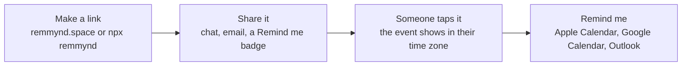

<p align="center">
  <a href="https://remmynd.space">
    <picture>
      <source media="(prefers-color-scheme: dark)" srcset="brand/logo/remmynd-logo-white.svg">
      
    </picture>
  </a>
</p>

<p align="center"><strong>Reminders, as a link.</strong><br>
Type what and when. Share the link. Anyone who taps it saves it to their calendar in one tap.</p>

<p align="center">
  <a href="https://www.npmjs.com/package/remmynd"></a>
  <a href="https://github.com/Remmynd/remmynd/actions/workflows/ci.yml"></a>
  <a href="https://github.com/Remmynd/remmynd/actions/workflows/live-check.yml"></a>
  
  <a href="LICENSE"></a>
</p>

<p align="center">
  <a href="https://remmynd.space"><strong>remmynd.space</strong></a> ·
  <a href="docs/PRINCIPLES.md">Principles</a> ·
  <a href="docs/ARCHITECTURE.md">Architecture</a> ·
  <a href="CHANGELOG.md">Changelog</a>
</p>

<p align="center">
  <a href="https://remmynd.space"></a>
</p>

---

## Why

Most "add to calendar" tools want an account, a dashboard and your visitors' data. remmynd wants none of that.

- **No sign-up**, for you or for the people you share with.
- **Private by design.** The whole reminder lives in the link, after the `#`, which browsers never send to a server. remmynd.space can't see what anyone is reminded about.
- **One tap to save.** "Remind me" picks the right calendar for the device: Apple Calendar on iPhone, iPad and Mac Safari, Google Calendar everywhere else. Outlook, Microsoft 365, the phone's share sheet (Reminders, Notes) and plain text are one tap away.
- **Sleep-safe.** If an event falls between 11 PM and 7 AM for a visitor, they can be reminded at 9 AM their time instead.
- **Phone notifications.** Remind me also turns on an alert 1 hour before and when it starts, where the device allows it, with Snooze on Android and desktop. The event details stay on your device.
- **Free and open source** under the MIT licence. Host your own copy if you like.

## Use it

### On the web

Go to [remmynd.space](https://remmynd.space) and write it in one line, like `Demo day Fri 5pm zoom.us/j/123`. The ticket fills in as you type, and the What, When and Where chips let you fix any part. Press Enter: the link is made and copied, ready to share. Pasting an invitation works too.

Whoever opens the link taps **Remind me** once: the event goes to their calendar (they confirm it there), notifications turn on where their device allows, and the ticket shows their reminder stack. **Coming up** lists the reminders held on that device and **My links** the links made on it; both stay on the device.

### Put a Remind me button on your site

[](https://remmynd.space/example)

```html
<a href="YOUR-REMMYND-LINK" target="_blank" rel="noopener">
  
</a>
```

Markdown:

```md
[](YOUR-REMMYND-LINK)
```

A dark version is at `https://remmynd.space/badge-dark.svg`.

### From the command line

```sh
npx remmynd "Demo day" --at "2026-12-05 18:00" --tz Asia/Kolkata --where https://lu.ma/demo
```

```text
Options
  --at, -a       When, e.g. "2026-12-05 18:00" (local to --tz) or an ISO time with Z
  --tz, -z       IANA time zone for --at (default: your system zone)
  --where, -w    A place or a link
  --notes, -n    One line of notes
  --host         Who is hosting
  --length, -l   Minutes (default 60)
  --private, -p  Make a private link (/#…): no preview, never reaches a server
  --ics [file]   Also write an .ics file ("-" prints it)
  --badge <fmt>  Print a Remind me badge snippet: html or md
  --dark         Use the dark badge
  --google       Also print a Google Calendar link
  --json         Print everything as JSON
  --base <url>   Use your own remmynd host

remmynd read <link>   Show what is inside a remmynd link (shared or private)
```

### From a script, a spreadsheet or an AI assistant

Write the reminder into the address. remmynd turns it into a link:

```text
https://remmynd.space/new?t=Demo+day&at=2026-12-05T18:00&tz=Asia/Kolkata&l=https://lu.ma/demo
```

| Parameter | Meaning |
|---|---|
| `t` | Title (required) |
| `at` | When, `YYYY-MM-DDTHH:mm`, optionally with `Z` or an offset like `+05:30` (required) |
| `tz` | IANA time zone for `at`, like `Asia/Kolkata` |
| `d` | Length in minutes (default 60) |
| `l` | Place or link |
| `n` | Notes |
| `h` | Host |

With `tz`, or a `Z` or offset in `at`, the address redirects to the shared link straight away. Without one, the time is read in the visitor's own time zone. If the title or time is missing, the maker opens with what was given.

### In your code

```sh
npm install remmynd
```

```js
import { createLink, toICS, googleCalendarUrl, decode, fromQuery, parse } from "remmynd";

const event = {
  title: "Demo day",
  start: "2026-12-05 18:00",
  timeZone: "Asia/Kolkata",
  location: "https://lu.ma/demo",
  durationMinutes: 90
};

createLink(event);                     // https://remmynd.space/r/eyJ0Ijoi...  shared: chat apps preview it
createLink(event, { private: true });  // https://remmynd.space/#eyJ0Ijoi...   private: never reaches a server
toICS(event);                          // .ics text with alerts 1 hour before and at the start
googleCalendarUrl(event);              // Google Calendar "add event" link
decode(link);                          // { title, start: Date, durationMinutes, location, notes, host, timeZone }
fromQuery("t=Demo+day&at=2026-12-05T18:00&tz=Asia/Kolkata");  // an event, from /new-style parameters
parse("Demo day Fri 5pm zoom.us/j/123");  // { title: "Demo day", start: Date, dur: null, place, tokens }
```

Zero dependencies. Works in Node 20+, Deno, Bun, Cloudflare Workers and browsers. Types included.

## How a link works

Every reminder is a small JSON object, base64url-encoded into the link. It comes in two forms with the same payload:

```text
https://remmynd.space/r/eyJ0IjoiRGVtbyBkYXkiLCJzIjoiaHRxc3UifQ   shared (the default)
https://remmynd.space/#eyJ0IjoiRGVtbyBkYXkiLCJzIjoiaHRxc3UifQ    private, and every 1.x link
                        └──────── base64url JSON ─────────┘
```

- **Shared** links put the payload in the path, so chat apps can show the title and time in a preview card. The Worker reads it only to fill those preview tags. It stores and logs nothing, and the page is never cached.
- **Private** links keep the payload after `#`, which browsers never send to a server. Turn on **Private link** in the maker, use `createLink(event, { private: true })`, or `npx remmynd … --private`.

| Key | Meaning |
|---|---|
| `t` | Title |
| `s` | Start, in minutes since 1970 (UTC), base 36 |
| `d` | Length in minutes (omitted when 60) |
| `l` | Place or link |
| `n` | Notes |
| `h` | Host |
| `z` | The host's IANA time zone, like `Asia/Kolkata` (optional; shows "Host time" and makes the preview readable) |

Times are stored in UTC and shown in each visitor's own time zone. Readers ignore keys they don't know, so old links keep working and new keys stay optional.

Saved events include the reminder link and a short "Made with remmynd.space" line in their notes. Nothing about the person saving the event is collected or added.



The full picture, including how requests are routed, how the `/ics` fallback works and how phone alerts stay private, is in [docs/ARCHITECTURE.md](docs/ARCHITECTURE.md).

## Privacy

Free, no sign-up, no tracking. Your reminder lives in the link and on your device. For phone alerts we keep only an anonymous ping time, deleted once it's sent.

- No accounts, no cookies, no analytics, no tracking.
- The reminder lives in the link. A shared link (`/r/…`) passes through remmynd.space so chat apps can show its title and time; the Worker reads it only to fill those preview tags, and stores and logs nothing. A private link (`/#…`) keeps everything after `#`, which browsers never send to a server.
- **Notifications** (optional, only when you allow them after Remind me): the event's title, time and link are saved on your device, in the browser's own storage. The server stores only three things per alert: a random id, your browser's anonymous push address, and when to ping it. At that time it sends an empty push; your device looks up what's due and shows it. The row is deleted as soon as it's sent. See [`worker/push.js`](worker/push.js) and [`worker/schema.sql`](worker/schema.sql).
- `/ics` is used only by iPhone in-app browsers (Instagram, LinkedIn, Chrome on iOS), which ignore calendar files made inside the page. It builds the file from the link in memory and keeps nothing.

## Self-host

remmynd runs on Cloudflare Workers: the files in `public/` are served as static assets, and `worker/index.js` handles shared `/r/` links and their previews, `/new`, `/ics`, `/changelog`, `/stats`, the `www` redirect, named pages like `/example`, and the `/push/` routes with a cron that sends due alerts.

```sh
git clone https://github.com/Remmynd/remmynd.git
cd remmynd
npx wrangler login
npm run ship      # runs the tests, then deploys
```

Change `name` and the `routes` in `wrangler.toml` to your own Worker name and domain first. To deploy on every push to `main`, connect your fork in Cloudflare (Workers & Pages → your Worker → Settings → Builds) with `main` as the production branch ([details](docs/RELEASING.md#automatic-deploys)).

To turn on notifications, run this once. It creates the D1 database and its table, makes a VAPID key pair, stores the private key as a Worker secret and fills in `wrangler.toml`:

```sh
npm run push:setup
```

Any static host works for the site alone, with private links: shared `/r/` links, `/new`, phone alerts and the iPhone in-app browser fallback need the Worker.

## Develop

```sh
git clone https://github.com/Remmynd/remmynd.git
cd remmynd
npm test         # library, CLI, site and Worker checks
npm run dev      # runs the site and Worker locally
npm run check    # tests plus a Worker build check, the same as CI
```

No install step: there are no dependencies. See [CONTRIBUTING.md](CONTRIBUTING.md).

## Documentation

| Doc | What's in it |
|---|---|
| [remmynd.space/docs](https://remmynd.space/docs) | The same guide on the website, with [why remmynd](https://remmynd.space/why), [for hosts](https://remmynd.space/hosts) and the [roadmap](https://remmynd.space/roadmap) |
| [Principles](docs/PRINCIPLES.md) | Why remmynd exists, what it will and won't do, and how changes are decided |
| [Architecture](docs/ARCHITECTURE.md) | The link format, request routing, hosting and the delivery pipeline, with diagrams |
| [Releasing and operations](docs/RELEASING.md) | Deploys, releases, versioning, rollback and one-time setup |
| [Changelog](CHANGELOG.md) | Every release, newest first |
| [Contributing](CONTRIBUTING.md) | How to propose and test a change |
| [Security](SECURITY.md) | How to report a vulnerability |
| [Brand](brand/BRAND.md) | Logo, colours, type and voice |

## Limits

- Calendar apps always ask for one confirming tap. No website can add an event silently.
- A saved event does not update if the original link changes. Make a new link for a new time.
- Notifications use your phone's own sound; websites can't choose a custom one. On iPhone they need remmynd added to the Home Screen (iOS 16.4 and later), and they don't show Snooze or Open buttons.
- Clearing the browser's website data removes saved reminders from Coming up and stops their alerts.

## Brand

Logos, icons and banners are in [`brand/`](brand/). See [brand/BRAND.md](brand/BRAND.md) for colours, type and usage.

## Licence

[MIT](LICENSE) © zoof04

---

<p align="center">Built and maintained by <a href="https://zoof04.com">zoof04</a>.</p>
