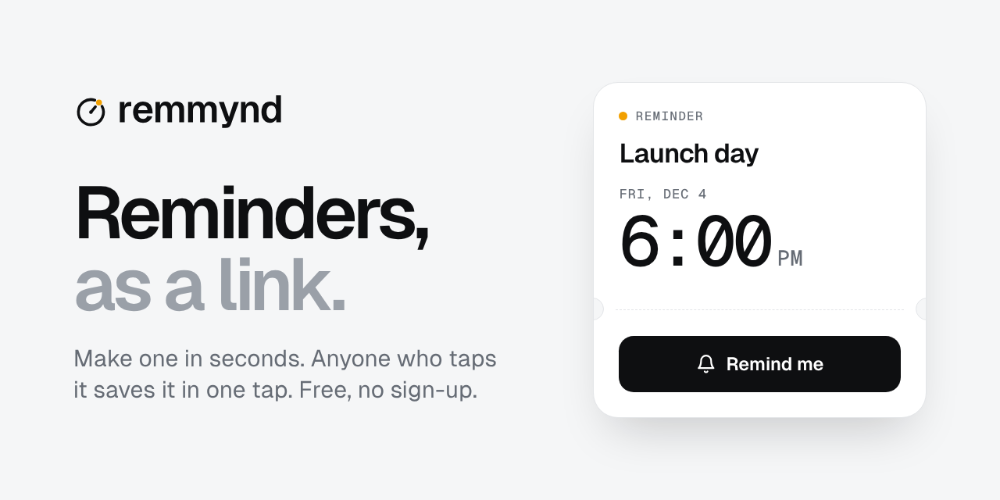
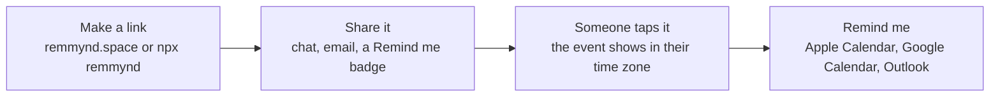

<p align="center">
  <a href="https://remmynd.space">
    <picture>
      <source media="(prefers-color-scheme: dark)" srcset="brand/logo/remmynd-logo-white.svg">
      
    </picture>
  </a>
</p>

<p align="center"><strong>Reminders that make sure it happens.</strong><br>
Write it in one line and share the link. Anyone who taps it is reminded in layers and followed through until it's done. No account needed.</p>

<p align="center">
  <a href="https://www.npmjs.com/package/remmynd"></a>
  <a href="https://github.com/Remmynd/remmynd/actions/workflows/ci.yml"></a>
  <a href="https://github.com/Remmynd/remmynd/actions/workflows/live-check.yml"></a>
  
  <a href="LICENSE"></a>
</p>

<p align="center">
  <a href="https://remmynd.space"><strong>remmynd.space</strong></a> ·
  <a href="https://remmynd.space/why">Why</a> ·
  <a href="https://remmynd.space/docs">Docs</a> ·
  <a href="docs/PRINCIPLES.md">Principles</a> ·
  <a href="docs/ARCHITECTURE.md">Architecture</a> ·
  <a href="CHANGELOG.md">Changelog</a>
</p>

<p align="center">
  <a href="https://remmynd.space"></a>
</p>

---

## Why

Most "add to calendar" tools want an account, a dashboard and your visitors' data. remmynd wants none of that.

- **No account needed**, for you or for the people you share with. Sign in only if you want your reminders on every device and by email.
- **One line in.** Write `Demo day Fri 5pm zoom.us/j/123`, or paste an invitation. The ticket fills in as you type, and Enter makes the link.
- **Reminded in layers.** One tap on Remind me sends the event to the calendar (Apple Calendar on iPhone, iPad and Mac Safari, Google Calendar elsewhere, with Outlook, Office 365 and more one tap away), turns on phone alerts an hour before and at the start where the device allows, and holds the reminder on the device.
- **Followed through.** At the start the ticket offers Open the link, Not yet and Done. It asks once whether you made it, and nudges up to three times if you want.
- **Private where it counts.** The reminder lives in the link. A shared link passes through remmynd.space only to fill its chat preview, and is never stored or logged; a private link never reaches a server. For phone alerts we keep only an anonymous ping time, deleted once it's sent.
- **Sleep-safe.** If an event falls between 11 PM and 7 AM for a visitor, they can be reminded at 9 AM their time instead.
- **Free and open source** under the MIT licence. Host your own copy if you like.

## Use it

### On the web

Go to [remmynd.space](https://remmynd.space) and write it in one line, like `Demo day Fri 5pm zoom.us/j/123`. The ticket fills in as you type, and the What, When and Where chips let you fix any part. Press Enter: the link is made and copied, ready to share. Pasting an invitation works too.

Whoever opens the link taps **Remind me** once: the event goes to their calendar (they confirm it there), notifications turn on where their device allows, and the ticket shows their reminder stack. **Coming up** lists the reminders held on that device and **My links** the links made on it; both stay on the device.

### Put a Remind me button on your site

[](https://remmynd.space/example)

```html
<a href="YOUR-REMMYND-LINK" target="_blank" rel="noopener">
  
</a>
```

Markdown:

```md
[](YOUR-REMMYND-LINK)
```

A dark version is at `https://remmynd.space/badge-dark.svg`.

### Put the reminder card on your page

An iframe of `/embed/` and your shared link's code shows the reminder as a card: the moment ring, the title, the time in each visitor's own zone, and a Remind me button. Add `?theme=dark` or `?theme=light` to pin a theme.

```html
<iframe src="https://remmynd.space/embed/YOUR-LINK-CODE" title="Reminder: Demo day" width="440" height="112" style="width:100%;max-width:440px;border:0" loading="lazy"></iframe>
```

`embedHTML(link)` in the library and `--embed` on the command line write it for you. Private links can't be embedded, because they never reach a server.

### The live badge

A picture that counts down, for READMEs, forums and any page that takes an image: `/b/` and your shared link's code, then `.svg`. It ticks with CSS alone, turns to Live now at the start and Ended at the end, and follows the viewer's light or dark setting unless you add `?theme=dark` or `?theme=light`. `?size=mini` gives a one-line version.

```md
[](https://remmynd.space/r/YOUR-LINK-CODE)
```

`liveBadgeHTML(link)` and `liveBadgeMarkdown(link)` in the library, or `--live-badge html` and `--live-badge md` on the command line, write it for you. For Discord, `discordLine(link)` or `--discord` writes `Demo day starts <t:1794569400:R>` and the link: Discord shows the time as a countdown in each reader's own zone. Private links have no live badge, because they never reach a server.

### From the command line

```sh
npx remmynd "Demo day" --at "2026-12-05 18:00" --tz Asia/Kolkata --where https://lu.ma/demo
```

```text
Options
  --at, -a       When, e.g. "2026-12-05 18:00" (local to --tz) or an ISO time with Z
  --tz, -z       IANA time zone for --at (default: your system zone)
  --where, -w    A place or a link
  --notes, -n    One line of notes
  --host         Who is hosting
  --length, -l   Minutes (default 60)
  --private, -p  Make a private link (/#…): no preview, never reaches a server
  --ics [file]   Also write an .ics file ("-" prints it)
  --badge <fmt>  Print a Remind me badge snippet: html or md
  --dark         Use the dark badge
  --google       Also print a Google Calendar link
  --json         Print everything as JSON
  --base <url>   Use your own remmynd host

remmynd read <link>   Show what is inside a remmynd link (shared or private)
```

### From a script, a spreadsheet or an AI assistant

Write the reminder into the address. remmynd turns it into a link:

```text
https://remmynd.space/new?t=Demo+day&at=2026-12-05T18:00&tz=Asia/Kolkata&l=https://lu.ma/demo
```

| Parameter | Meaning |
|---|---|
| `t` | Title (required) |
| `at` | When, `YYYY-MM-DDTHH:mm`, optionally with `Z` or an offset like `+05:30` (required) |
| `tz` | IANA time zone for `at`, like `Asia/Kolkata` |
| `d` | Length in minutes (default 60) |
| `l` | Place or link |
| `n` | Notes |
| `h` | Host |

With `tz`, or a `Z` or offset in `at`, the address redirects to the shared link straight away. Without one, the time is read in the visitor's own time zone. If the title or time is missing, the maker opens with what was given.

### As a connector for AI assistants

Assistants that take MCP connectors (remote MCP servers) can add remmynd at `https://remmynd.space/mcp`, then make a reminder link from what you ask in your own words. No account and no key.

| Tool | What it does |
|---|---|
| `make_reminder_link` | A link from a title and a start (`YYYY-MM-DDTHH:mm` with an IANA `time_zone`, or an exact time), with optional length, place or link, notes and host |
| `make_reminder_from_text` | A link from one line, read the way the app reads it: "Demo day Fri 5pm zoom.us/j/123" |
| `read_reminder_link` | What a remmynd link holds |

It speaks MCP 2026-07-28 and the earlier versions back to 2025-03-26, over Streamable HTTP. It stores and logs nothing: it only turns words into a link and back, with the same library as the site.

### In your code

```sh
npm install remmynd
```

```js
import { createLink, toICS, googleCalendarUrl, decode, fromQuery, parse } from "remmynd";

const event = {
  title: "Demo day",
  start: "2026-12-05 18:00",
  timeZone: "Asia/Kolkata",
  location: "https://lu.ma/demo",
  durationMinutes: 90
};

createLink(event);                     // https://remmynd.space/r/eyJ0Ijoi...  shared: chat apps preview it
createLink(event, { private: true });  // https://remmynd.space/#eyJ0Ijoi...   private: never reaches a server
toICS(event);                          // .ics text with alerts 1 hour before and at the start
googleCalendarUrl(event);              // Google Calendar "add event" link
decode(link);                          // { title, start: Date, durationMinutes, location, notes, host, timeZone }
fromQuery("t=Demo+day&at=2026-12-05T18:00&tz=Asia/Kolkata");  // an event, from /new-style parameters
parse("Demo day Fri 5pm zoom.us/j/123");  // { title: "Demo day", start: Date, dur: null, place, tokens }
```

Zero dependencies. Works in Node 20+, Deno, Bun, Cloudflare Workers and browsers. Types included.

## How a link works

Every reminder is a small JSON object, base64url-encoded into the link. It comes in two forms with the same payload:

```text
https://remmynd.space/r/eyJ0IjoiRGVtbyBkYXkiLCJzIjoiaHRxc3UifQ   shared (the default)
https://remmynd.space/#eyJ0IjoiRGVtbyBkYXkiLCJzIjoiaHRxc3UifQ    private, and every 1.x link
                        └──────── base64url JSON ─────────┘
```

- **Shared** links put the payload in the path, so chat apps can show the title and time in a preview card. The Worker reads it only to fill those preview tags. It stores and logs nothing, and the page is never cached.
- **Private** links keep the payload after `#`, which browsers never send to a server. Turn on **Private link** in the maker, use `createLink(event, { private: true })`, or `npx remmynd … --private`.

| Key | Meaning |
|---|---|
| `t` | Title |
| `s` | Start, in minutes since 1970 (UTC), base 36 |
| `d` | Length in minutes (omitted when 60) |
| `l` | Place or link |
| `n` | Notes |
| `h` | Host |
| `z` | The host's IANA time zone, like `Asia/Kolkata` (optional; shows "Host time" and makes the preview readable) |

Times are stored in UTC and shown in each visitor's own time zone. Readers ignore keys they don't know, so old links keep working and new keys stay optional.

Saved events include the reminder link and a short "Made with remmynd.space" line in their notes. Nothing about the person saving the event is collected or added.



The full picture, including how requests are routed, how the `/ics` fallback works and how phone alerts stay private, is in [docs/ARCHITECTURE.md](docs/ARCHITECTURE.md).

## Privacy

Free, no account needed, no tracking. Your reminder lives in the link and on your device. For phone alerts we keep only an anonymous ping time, deleted once it's sent. If you sign in, we keep your email address and your reminders so they sync across your devices and can be emailed to you. Private links stay on your device. Delete it all any time.

- No account needed, no analytics, no tracking. No cookies, except one that keeps you signed in if you choose to sign in.
- The reminder lives in the link. A shared link (`/r/…`) passes through remmynd.space so chat apps can show its title and time; the Worker reads it only to fill those preview tags, and stores and logs nothing. A private link (`/#…`) keeps everything after `#`, which browsers never send to a server.
- **Notifications** (optional, only when you allow them after Remind me): the event's title, time and link are saved on your device, in the browser's own storage. The server stores only three things per alert: a random id, your browser's anonymous push address, and when to ping it. At that time it sends an empty push; your device looks up what's due and shows it. The row is deleted as soon as it's sent. See [`worker/push.js`](worker/push.js) and [`worker/schema.sql`](worker/schema.sql).
- **Signing in** (optional) keeps your email address, your passkeys' public keys, a sign-in session, and your reminders and links (never private links) so they sync across devices and can be emailed to you. Reminder emails are sent through [Resend](https://resend.com), which receives the address and the email to deliver it. Delete your account from the app and everything goes with it. See [`worker/account.js`](worker/account.js).
- `/ics` is used only by iPhone in-app browsers (Instagram, LinkedIn, Chrome on iOS), which ignore calendar files made inside the page. It builds the file from the link in memory and keeps nothing.

## Self-host

remmynd runs on Cloudflare Workers: the files in `public/` are served as static assets, and `worker/index.js` handles shared `/r/` links and their previews, `/new`, `/share`, `/embed/` (the reminder card), `/b/` (the live badge), `/mcp` (the connector for AI assistants), `/ics`, `/changelog`, `/stats`, the `www` redirect, named pages like `/example`, and the `/push/` routes with a cron that sends due alerts.

```sh
git clone https://github.com/Remmynd/remmynd.git
cd remmynd
npx wrangler login
npm run ship      # runs the tests, then deploys
```

Change `name` and the `routes` in `wrangler.toml` to your own Worker name and domain first. To deploy on every push to `main`, connect your fork in Cloudflare (Workers & Pages → your Worker → Settings → Builds) with `main` as the production branch ([details](docs/RELEASING.md#automatic-deploys)).

To turn on notifications, run this once. It creates the D1 database and its table, makes a VAPID key pair, stores the private key as a Worker secret and fills in `wrangler.toml`:

```sh
npm run push:setup
```

Any static host works for the site alone, with private links: shared `/r/` links, `/new`, phone alerts and the iPhone in-app browser fallback need the Worker.

## Develop

```sh
git clone https://github.com/Remmynd/remmynd.git
cd remmynd
npm test         # library, CLI, site and Worker checks
npm run dev      # runs the site and Worker locally
npm run check    # tests plus a Worker build check, the same as CI
```

No install step: there are no dependencies. See [CONTRIBUTING.md](CONTRIBUTING.md).

## Documentation

| Doc | What's in it |
|---|---|
| [remmynd.space/docs](https://remmynd.space/docs) | The same guide on the website, with [why remmynd](https://remmynd.space/why), [for hosts](https://remmynd.space/hosts) and the [roadmap](https://remmynd.space/roadmap) |
| [Principles](docs/PRINCIPLES.md) | Why remmynd exists, what it will and won't do, and how changes are decided |
| [Architecture](docs/ARCHITECTURE.md) | The link format, request routing, hosting and the delivery pipeline, with diagrams |
| [Releasing and operations](docs/RELEASING.md) | Deploys, releases, versioning, rollback and one-time setup |
| [Changelog](CHANGELOG.md) | Every release, newest first |
| [Contributing](CONTRIBUTING.md) | How to propose and test a change |
| [Security](SECURITY.md) | How to report a vulnerability |
| [Brand](brand/BRAND.md) | Logo, colours, type and voice |

## Limits

- Calendar apps always ask for one confirming tap. No website can add an event silently.
- A saved event does not update if the original link changes. Make a new link for a new time.
- Notifications use your phone's own sound; websites can't choose a custom one. On iPhone they need remmynd added to the Home Screen (iOS 16.4 and later), and they don't show Snooze or Open buttons.
- Clearing the browser's website data removes saved reminders from Coming up and stops their alerts.

## Brand

Logos, icons and banners are in [`brand/`](brand/). See [brand/BRAND.md](brand/BRAND.md) for colours, type and usage.

## Licence

The code is [MIT](LICENSE)-licensed. © 2026 Zoof04 Inc.

## Name and logo

The remmynd name, the logo and the moment ring belong to Zoof04 Inc. They are not covered by the MIT licence. You may use them to write about or link to remmynd. A fork or a copy you host must use its own name and logo, and must not suggest that Zoof04 Inc. makes, runs or endorses it. See [brand/BRAND.md](brand/BRAND.md).

---

<p align="center">Built and maintained by <a href="https://zoof04.com">Zoof04 Inc.</a></p>
