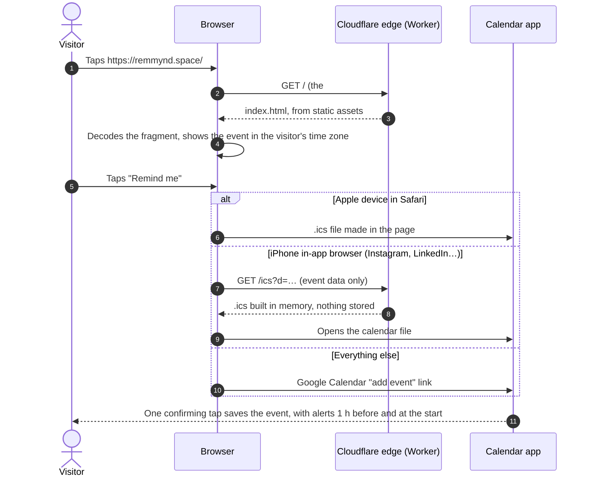
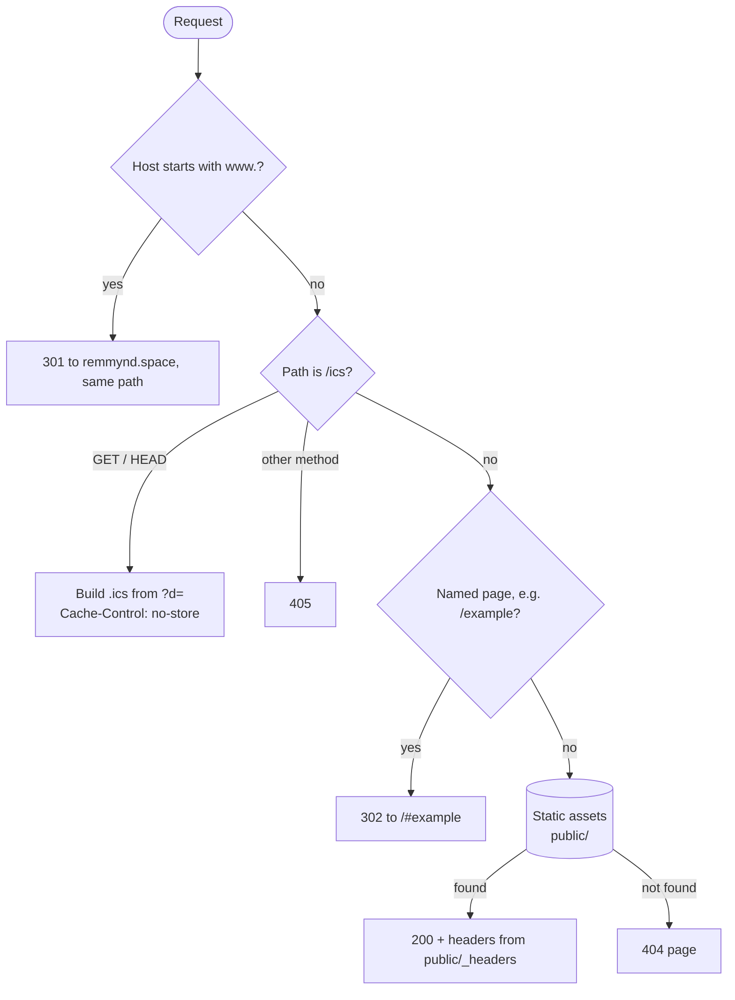
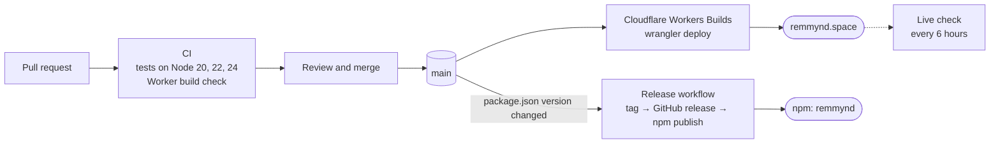

# Architecture

remmynd has three parts that share one link format:

| Part | Where | What it does |
|---|---|---|
| **Website** | `public/index.html` | Makes links, shows reminders, opens the visitor's calendar. One file, no build step. |
| **Worker** | `worker/` | Serves the site on Cloudflare, redirects `www`, and builds `.ics` files for iPhone in-app browsers. |
| **Library and CLI** | `lib/`, `bin/` | The `remmynd` npm package and `npx remmynd`. Zero dependencies. |

The tests in `test/` check that the website and the library produce identical links, so the three never drift apart.

## The link

Everything about a reminder lives in the URL fragment, the part after `#`. Browsers never send the fragment to a server, so remmynd.space never sees what anyone is reminded about.

```text
https://remmynd.space/#eyJ0IjoiRGVtbyBkYXkiLCJzIjoiaHRxc3UifQ
└──────── page ──────┘ └──── base64url-encoded JSON ────────┘
                         {"t":"Demo day","s":"htqsu"}
```

| Key | Meaning | Notes |
|---|---|---|
| `t` | Title | Required |
| `s` | Start | Minutes since 1970 UTC, base 36 |
| `d` | Length in minutes | Omitted when 60 |
| `l` | Place or link | Optional |
| `n` | Notes | Optional |
| `h` | Host | Optional |

The format is a public contract. New keys must be optional and old links must keep working.

## What happens when someone taps a link



## How requests are routed

Every request goes through `worker/index.js` first (`run_worker_first = true` in `wrangler.toml`), then falls through to the static files in `public/`.



Headers for static files live in `public/_headers`: security headers on every response, `no-cache` on the service worker so updates arrive immediately, a year of caching for icons and a day for badges.

## Hosting

| Piece | Setting |
|---|---|
| Worker | `remmynd` on Cloudflare Workers, static assets from `public/` |
| Domains | `remmynd.space` and `www.remmynd.space`, attached as Worker custom domains in `wrangler.toml` |
| DNS | Cloudflare (`june` and `maxim.ns.cloudflare.com`); records are managed by the Worker's custom domains |
| HTTPS | Cloudflare certificates, HTTP redirects to HTTPS |
| Preview URLs | Off |

## Delivery pipeline



Details, setup and rollback: [RELEASING.md](RELEASING.md).

## Repository layout

```text
public/          the website: index.html, icons, badges, service worker, _headers
worker/          Cloudflare Worker: routing and the /ics route
lib/             the npm library (remmynd.js) and its TypeScript types
bin/             the npx remmynd command
test/            node:test suite for the library, CLI, site and Worker
scripts/         release helpers
brand/           logo, mark, avatars, social images and the brand guide
docs/            principles, architecture and the release runbook
.github/         CI, deploy and release workflows, issue and PR templates
wrangler.toml    Worker configuration
```
