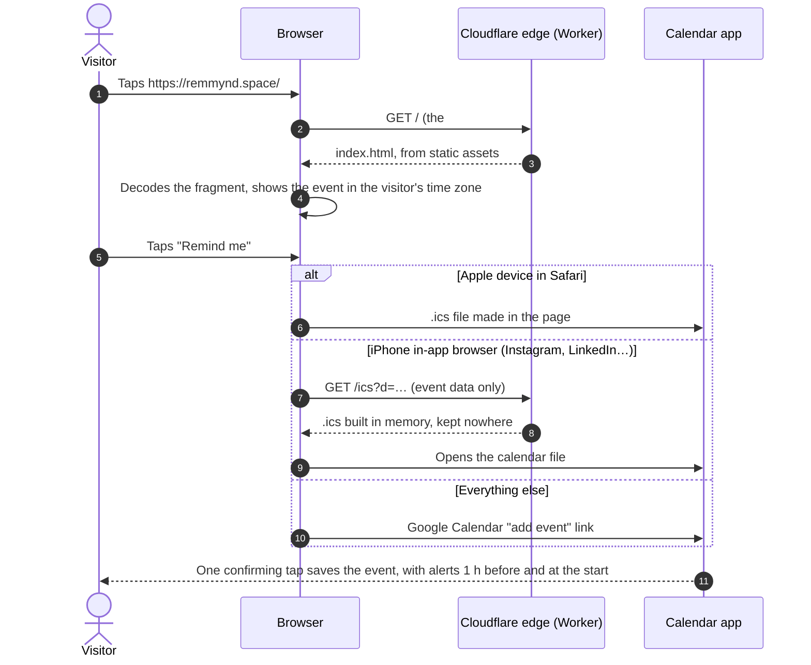
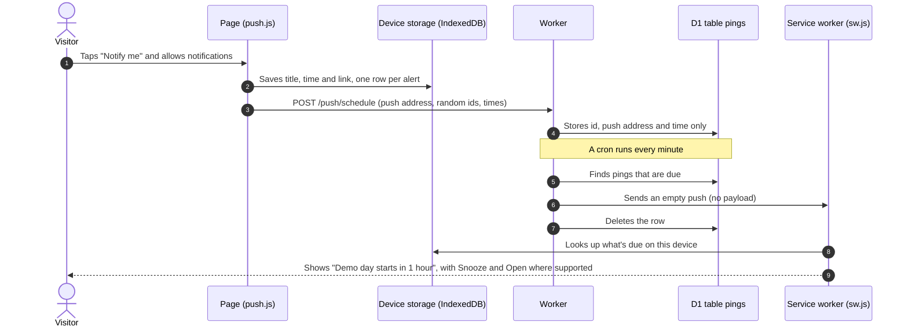
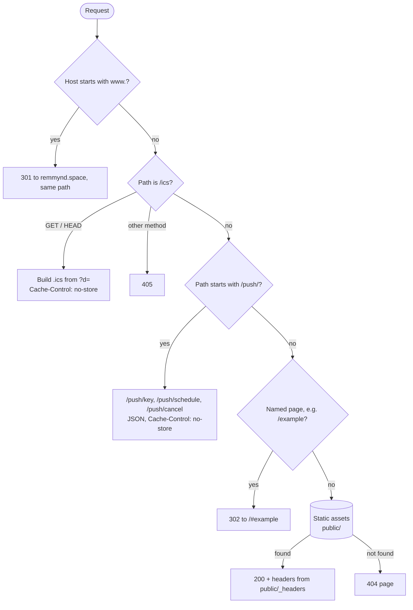

# Architecture

remmynd has three parts that share one link format:

| Part | Where | What it does |
|---|---|---|
| **Website** | `public/` | Makes links, shows reminders, opens the visitor's calendar. `index.html` is the app, `app.css` its styles on the 2.0 design tokens, `fonts/` the self-hosted Geist fonts, `push.js` adds Notify me, `sw.js` works offline and shows alerts. No build step. |
| **Worker** | `worker/` | Serves the site on Cloudflare, redirects `www`, builds `.ics` files for iPhone in-app browsers, and wakes devices for phone alerts. |
| **Library and CLI** | `lib/`, `bin/` | The `remmynd` npm package and `npx remmynd`. Zero dependencies. |

The tests in `test/` check that the website and the library produce identical links, so the three never drift apart.

## The link

Everything about a reminder lives in the URL fragment, the part after `#`. Browsers never send the fragment to a server, so remmynd.space never sees what anyone is reminded about.

```text
https://remmynd.space/#eyJ0IjoiRGVtbyBkYXkiLCJzIjoiaHRxc3UifQ
└──────── page ──────┘ └──── base64url-encoded JSON ────────┘
                         {"t":"Demo day","s":"htqsu"}
```

| Key | Meaning | Notes |
|---|---|---|
| `t` | Title | Required |
| `s` | Start | Minutes since 1970 UTC, base 36 |
| `d` | Length in minutes | Omitted when 60 |
| `l` | Place or link | Optional |
| `n` | Notes | Optional |
| `h` | Host | Optional |

The format is a public contract. New keys must be optional and old links must keep working.

## What happens when someone taps a link



## How phone alerts work

Notify me is optional and needs the person's permission. Your reminder lives in the link and on your device. For phone alerts we keep only an anonymous ping time, deleted once it's sent.



| Detail | Value |
|---|---|
| Alerts per reminder | 1 hour before and at the start, or one 9 AM alert when sleep-safe is on |
| Server row | `id`, `endpoint`, `at`, `created` (`worker/schema.sql`); nothing about the event |
| Limits | 8 pings per request, 200 rows per device, at most 400 days ahead |
| Push services accepted | Google (FCM), Mozilla, Apple and Windows push hosts only |
| Cancelling | `POST /push/cancel` with the same push address; a device can only cancel its own pings |
| Gone devices | A 400, 403, 404 or 410 from the push service deletes every row for that address |
| iPhone | Needs remmynd on the Home Screen (iOS 16.4 and later); no Snooze or Open buttons |

## How requests are routed

Every request goes through `worker/index.js` first (`run_worker_first = true` in `wrangler.toml`), then falls through to the static files in `public/`.



Headers for static files live in `public/_headers`: security headers on every response, `no-cache` on the service worker so updates arrive immediately, a year of caching for icons and a day for badges.

## Hosting

| Piece | Setting |
|---|---|
| Worker | `remmynd` on Cloudflare Workers, static assets from `public/` |
| Domains | `remmynd.space` and `www.remmynd.space`, attached as Worker custom domains in `wrangler.toml` |
| DNS | Cloudflare (`june` and `maxim.ns.cloudflare.com`); records are managed by the Worker's custom domains |
| HTTPS | Cloudflare certificates, HTTP redirects to HTTPS |
| Preview URLs | Off |
| Push storage | D1 database `remmynd`, table `pings`, bound as `DB` |
| Push timing | Cron trigger every minute (`scheduled` in `worker/index.js`) |
| Push keys | VAPID public key in `wrangler.toml`, private key as the Worker secret `VAPID_PRIVATE_JWK` |
| Logs | Workers observability isn't turned on in `wrangler.toml`, and the Worker never logs request addresses |

## Delivery pipeline


Details, setup and rollback: [RELEASING.md](RELEASING.md).

## Repository layout

```text
public/          the website: index.html, app.css, fonts/, push.js, sw.js, icons, badges, manifest, _headers
worker/          Cloudflare Worker: routing, the /ics route and push (push.js, schema.sql)
lib/             the npm library (remmynd.js) and its TypeScript types
bin/             the npx remmynd command
test/            node:test suite for the library, CLI, site and Worker
scripts/         release helpers and push:setup
brand/           logo, mark, avatars, social images and the brand guide
docs/            principles, architecture and the release runbook
.github/         CI, release and live-check workflows, issue and PR templates
wrangler.toml    Worker configuration
```
