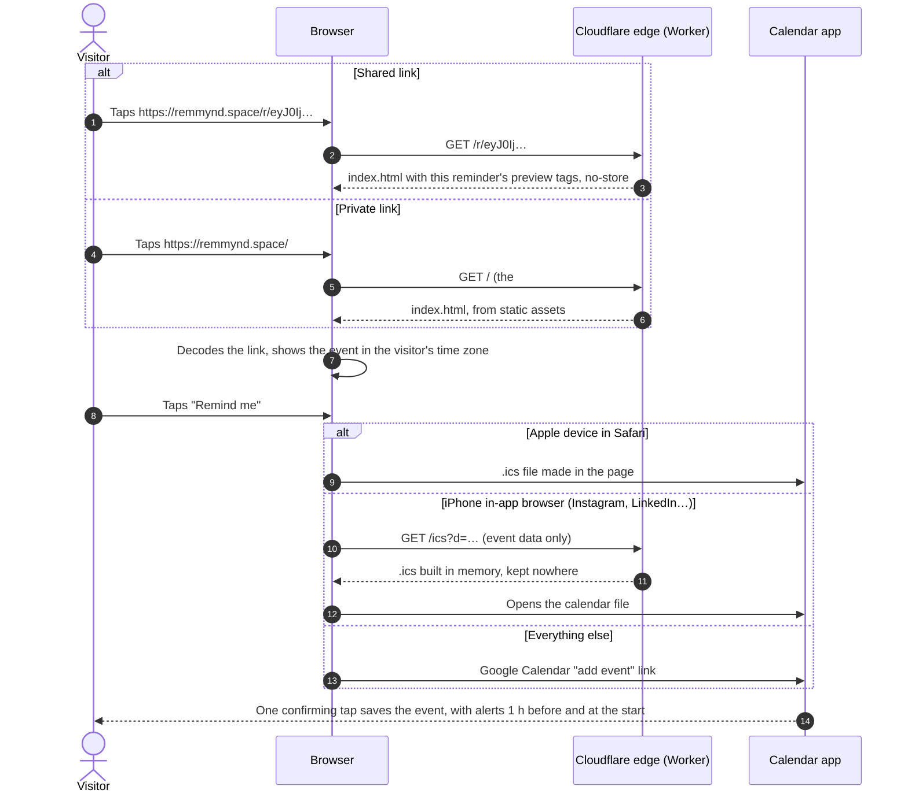
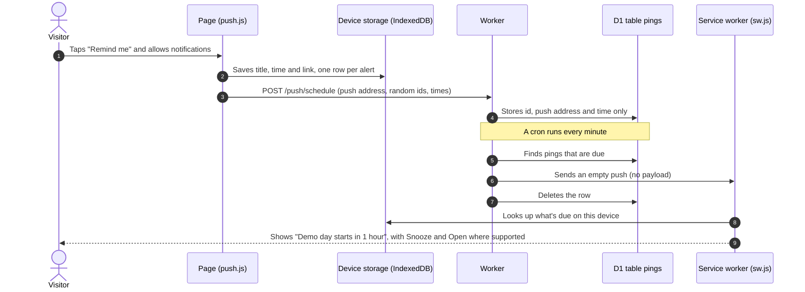
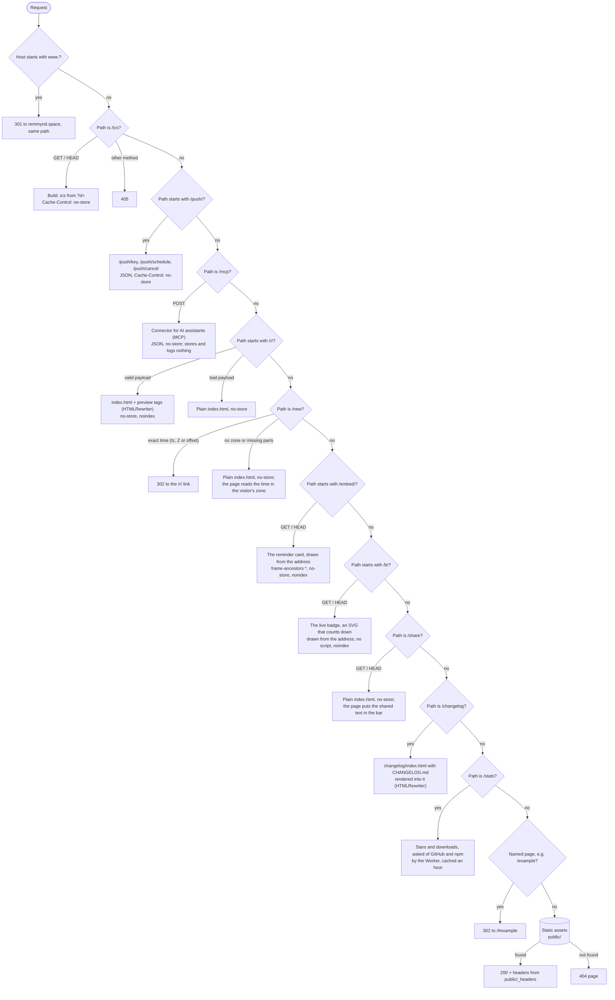

# Architecture

remmynd has three parts that share one link format:

| Part | Where | What it does |
|---|---|---|
| **Website** | `public/` | Makes links, shows reminders, opens the visitor's calendar. `index.html` is the markup, `app.js` the app (an ES module that imports `remmynd.js`, an exact copy of the library, to read typed lines and make links, and `ring.js`, the moment ring; `qr.js` draws QR codes and loads only when one is asked for), `app.css` its styles on the 2.0 design tokens, `fonts/` the self-hosted Geist fonts, `db.js` the on-device storage, `push.js` turns on notifications and fills the stack's Notification row, `sw.js` works offline and shows alerts. The website pages (`why/`, `hosts/`, `docs/`, `install/`, `roadmap/`, `privacy/`, `press/`, `changelog/`, one `index.html` each, and `404.html`) share the app's styles plus `site.css`, and `site.js` for the theme, the menu and the live numbers. No build step. |
| **Worker** | `worker/` | Serves the site on Cloudflare, adds link-preview tags to shared `/r/` links (`preview.js`), turns `/new` addresses into links, redirects `www`, builds `.ics` files for iPhone in-app browsers, renders `CHANGELOG.md` at `/changelog` (`changelog.js`), serves GitHub and npm numbers at `/stats` (`stats.js`), and wakes devices for phone alerts. It reads links with the library itself. |
| **Library and CLI** | `lib/`, `bin/` | The `remmynd` npm package and `npx remmynd`. Zero dependencies. |

The tests in `test/` check that the website, the library and the Worker produce identical links, so the three never drift apart.

## The link

Everything about a reminder lives in the link, as base64url-encoded JSON. The same payload comes in two forms:

```text
https://remmynd.space/r/eyJ0IjoiRGVtbyBkYXkiLCJzIjoiaHRxc3UifQ   shared (the default)
https://remmynd.space/#eyJ0IjoiRGVtbyBkYXkiLCJzIjoiaHRxc3UifQ    private, and every 1.x link
└──────── page ──────┘  └──── base64url-encoded JSON ────────┘
                          {"t":"Demo day","s":"htqsu"}
```

| Form | Reaches the server? | Used for |
|---|---|---|
| Shared `/r/<payload>` | Yes, in passing: the Worker reads it to fill the preview tags, then forgets it. Never stored, logged or cached. | Links meant to be shared in chat |
| Private `/#<payload>` | No. Browsers never send what follows `#`. | The **Private link** switch, and every 1.x link |
| Written by hand `/new?t=…&at=…` | Yes, in passing | Scripts, spreadsheets and AI assistants. Redirects to the shared form. |
| Public count `/count/<payload>` | Yes: one number per reminder, only when its host switched the count on (`c: 1`) | GET reads it; POST adds one on Remind me, once per device, only from this site, never after the end, at most 600 a minute per reminder and 20 a minute per network (Cloudflare's rate limiter, no address kept). The row is deleted 30 days after the end. |
| One line `/new?q=…` | Yes, in passing | The Siri shortcut and any link. Opens the app with the line in the bar; with a time in it, the link is made. |

| Key | Meaning | Notes |
|---|---|---|
| `t` | Title | Required |
| `s` | Start | Minutes since 1970 UTC, base 36 |
| `d` | Length in minutes | Omitted when 60 |
| `l` | Place or link | Optional |
| `n` | Notes | Optional |
| `h` | Host | Optional |
| `z` | The host's IANA time zone | Optional. The ticket shows "Host time"; the preview prints the time in this zone, or UTC without it |

The format is a public contract. New keys must be optional, readers ignore keys they don't know, and old links must keep working.

## What happens when someone taps a link



## How phone alerts work

Notifications are optional and need the person's permission: Remind me asks once, inside the tap, and the stack's Notification row turns them on or off. Your reminder lives in the link and on your device. For phone alerts we keep only an anonymous ping time, deleted once it's sent.



| Detail | Value |
|---|---|
| Alerts per reminder | 1 hour before, at the start, and a "did you make it?" check when it ends (start plus its length, or 30 minutes); with nudges on, 10, 20 and 30 minutes after the start. Sleep-safe: one 9 AM alert. Not yet: one alert at the chosen time |
| Stopping alerts | Done, re-planning or dropping cancels what's left; opening the link (or a nudge) stops the nudges. The device forgets them at once and tells the server with `POST /push/cancel` |
| Server row | `id`, `endpoint`, `at`, `created` (`worker/schema.sql`); nothing about the event |
| Limits | 8 pings per request, 200 rows per device, at most 400 days ahead |
| Push services accepted | Google (FCM), Mozilla, Apple and Windows push hosts only |
| Cancelling | `POST /push/cancel` with the same push address; a device can only cancel its own pings |
| Gone devices | A 400, 403, 404 or 410 from the push service deletes every row for that address |
| iPhone | Needs remmynd on the Home Screen (iOS 16.4 and later); no Snooze or Open buttons |

### On-device storage

IndexedDB `remmynd`, version 2, opened only through `public/db.js`, which the page and the service worker share. Nothing in it leaves the device.

| Store | Key | Holds |
|---|---|---|
| `alerts` | `id` (index `rkey`) | Phone alerts waiting to be shown |
| `reminders` | `rkey` | Reminders held on this device, shown in Coming up (`/#coming-up`). On the upgrade from version 1 it is built from the existing alerts, one per `rkey`. A reminder can carry a `plan` ("My plan", up to 120 characters): the service worker reads it when an alert shows and adds "Your plan: …" to every alert but the check, and the reminder emails repeat it. It is never put in the link |
| `links` | `share` | Links made on this device, shown in My links (`/#links`): title, start, when it was made, and whether it is private |

## The moment ring

`public/ring.js` draws the logo as a 24-hour dial of the viewer's own day (spec section 8): noon at the top, midnight at the bottom, the night from 22:00 to 06:00 shaded, and the reminder's time as the dot. It returns SVG markup; `app.css` colours it from the tokens and switches between states with one class, so Open to Held animates the gap closing.

| State | When |
|---|---|
| Open | Not held on this device |
| Held | Held (Remind me or a calendar option was tapped); kept in `reminders`, with which calendar it went to and the nudge switch |
| Soon | Held, and starting within the hour; a countdown shows beside it |
| Now | From the start until it ends |
| Kept | Marked done: Done on the ticket, or Done on the check alert |
| Missed | Ended, not done and not re-planned, or dropped |

Every ring is an image with a label that says the time and the state in words, for example "Day dial showing 5:00 in the afternoon, reminder set".

### Loaded only when asked for

The first visit downloads the app and nothing it might not use. These parts load the first time they're needed, through `import()`, and the service worker keeps them for offline use after that:

| Part | Files | Loads when |
|---|---|---|
| Search and commands | `palette.js`, `palette.css` | Ctrl or Cmd + K, or Search and commands in the menu. It lists reminders and links from on-device storage and presses the menu's own buttons for theme, sound, sign in and install, so the two never disagree |
| Floating countdown | `float.js`, `float.css` | "Float it above my windows" on a held reminder. It opens a Document Picture-in-Picture window (Chrome and Edge on a computer) that uses `app.css` and `float.css`, follows the theme, and runs its timer in the floating window so a background tab doesn't slow it. Where the browser has no such window the row isn't shown |
| Smart paste | `smartpaste.js`, `smartpaste.css` | A long paste or an image in the bar, and only where the browser has the Prompt API (`LanguageModel`, Chrome's on-device model). It offers to read the paste on the device; the model's answer, constrained by a JSON schema, becomes one line in the bar (a time written in another zone is moved into the reader's), so the app's own parser and live preview take over. Nothing is sent anywhere, and the module never makes a request |
| Talk | `talk.js`, `talk.css` | The first tap of the mic in the bar. The mic shows only where the browser has speech recognition (`SpeechRecognition`), on https, and not in the iPhone Home Screen app, where it doesn't work. What's said goes into the bar as if typed, so the parser and the live preview take over. When speech ends, a line with a clock time or "in 20 minutes" is made into the link as Enter makes it; a day alone, or nothing, stays in the bar with a hint. Where the browser can recognise speech on the device (`processLocally`), it's asked to. The module never makes a request and never measures the sound. `Permissions-Policy` grants the mic to this site only; the card and the badge don't get it |
| The live badge | `livebadge.js`, `livebadge.css` | The live badge on the ready screen |
| Story card | `story.js`, `story.css` | Story under Share it, or Add to story on a held ticket, which draws the joiner's card ("I'm in." and a held ring). The link is copied inside that tap, then the card is drawn on a 1080 by 1920 canvas on the device, from the band colours and `ring.js`'s own geometry (`GEOMETRY`), after `document.fonts.ready`. It prints the date and time from `describeWhen()`, never time left, and leaves the lower third empty for Instagram's Link and Countdown stickers. Share the card uses `navigator.share({ files })` where `canShare` allows it; otherwise Save picture downloads the PNG. A plain link to Snapchat's share address. Nothing is uploaded and the module makes no request |
| Sign-in | `account.js`, `account.css` | See below |

"Kept N of M this month" is part of the app itself: of the reminders whose time came this month (counted once they're over, or when they were marked done), how many were marked done. It only appears once one is kept.

## Optional sign-in, sync and email

No account is needed. Signing in is for people who want their reminders on every device and by email. The browser part (`public/account.js`, `account.css`) loads only when someone opens sign-in, or on a device that is signed in; the server part is `worker/account.js`, with passkeys checked by `worker/webauthn.js`.

| Piece | How it works |
|---|---|
| Sign in | A passkey (Face ID, Touch ID, screen lock), or a 6-digit code by email (it works inside the iPhone Home Screen app, where a link would open Safari). Codes expire in 10 minutes, allow 5 tries, and are limited to one a minute and five an hour per address |
| Passkeys | WebAuthn with "none" attestation. The browser hands over the public key (SPKI); sign-in checks the challenge, origin, relying party, user presence, signature (ES256, Ed25519 or RS256, with WebCrypto) and the counter. No libraries |
| Session | One HttpOnly, Secure, SameSite=Lax cookie (`rm_s`), 180 days; the server stores only its SHA-256. Every change is a JSON POST from this origin |
| Sync | Reminders and links travel as JSON items; the newest change wins, deletions are kept as tombstones for 90 days. Private links (`/#…`) are never sent |
| Email | Held reminders get an email 1 hour before and at the start (or once at a re-planned time), sent by the every-minute cron through Resend (`RESEND_API_KEY`, a Worker secret; `MAIL_FROM` defaults to `remmynd <reminders@remmynd.space>`). Every email has a one-click stop link |
| Delete | Deleting the account deletes the user, passkeys, sessions, items and pending emails at once |

Tables (`worker/schema.sql`, created on first use): `users`, `passkeys`, `sessions`, `codes`, `challenges`, `items`, `mails`, `sends`. For local testing, `DEV_SHOW_CODE=1` in `.dev.vars` returns the code in the response when no email key is set.

## Accessibility

The tests hold the app and the website to WCAG AA: every text and background pair from the design tokens meets 4.5:1 (3:1 for large text) in both themes, controls are at least 44 px (`--tap`), every sheet is a named modal dialog that keeps Tab inside it and gives focus back when it closes, every image has alt text, headings never skip a level, and all motion stops under `prefers-reduced-motion`. Every ring says its time and state to screen readers.

## How requests are routed

Every request goes through `worker/index.js` first (`run_worker_first = true` in `wrangler.toml`), then falls through to the static files in `public/`.



`/mcp` is the connector for AI assistants, a remote MCP server over Streamable HTTP (`worker/mcp.js`). It speaks MCP 2026-07-28, where every request carries its protocol version (checked against the `MCP-Protocol-Version`, `Mcp-Method` and `Mcp-Name` headers), and answers the older `initialize` handshake for clients on 2025-11-25 back to 2025-03-26, without minting sessions. Its three tools (`make_reminder_link`, `make_reminder_from_text`, `read_reminder_link`) call the same library as the site, so the links are identical; the connector gets no bindings, so it can't store anything, and it asks no other host for anything. A browser that opens `/mcp` is sent to `/docs#connector`.

`/embed/<payload>` is the reminder card other sites show in an iframe (`worker/embed.js`): the moment ring, title, time and a Remind me button that opens the `/r/` link in a new tab. Like `/r/`, the reminder is read from the address only to draw it, and the response is `no-store`. It has its own security policy, which lets any site frame it (`frame-ancestors *`) and allows only this site's `embed.css` and `embed.js` (the time in the visitor's zone). The card's first line is a countdown, "in 12 days", then "1d 04:12:09" inside 48 hours, "Live now" and "Ended", from `public/clock.js`, which the live badge uses too. The Worker writes its first value so the card is right before `embed.js` runs, and `embed.js` keeps it current: every second inside 48 hours, every 30 seconds before. `?screen=1` is the layout for big screens: the ring, the title, the countdown in large type and a QR code of the shared link drawn by `qr.js` on the Worker, with no button. `/embed/example` is the For hosts example. Private links aren't accepted, since they never reach a server.

`/b/<payload>.svg` is the live badge (`worker/badge.js`): a picture that counts down, for READMEs, forums and pages, wrapped in a link to the reminder. A picture shown through an image tag runs CSS animations but no script, so the Worker writes the time left at the moment of the request and CSS animations count down from there: each digit is a column of digits moved by steps and started part-way through with a negative delay, so even the first frame is right. The changes to Soon, Live now and Ended are delayed animations too, so a picture left open stays true. The picture holds no script, no links and no other file, and its security policy allows only its own style. Like `/r/`, the reminder is read from the address only to draw it; nothing is stored or logged. Pictures that tick send `Cache-Control: no-cache` (GitHub shows README pictures through its own proxy and asks for that), a far reminder is cached ten minutes and an ended one a day. `?theme=` pins a theme, `?size=mini` gives one line, and `/b/example.svg` is the For hosts example, always a little over a day away.

`/share` is where the Android share sheet sends text once remmynd is installed (`share_target` in the manifest). The Worker serves the app, which joins the shared title, text and link into one line in the bar and sets the address back to `/`; nothing is sent anywhere.

Website pages live in folders (`public/why/index.html`) and are served without the slash (`html_handling = "drop-trailing-slash"`): `/why/` redirects to `/why`. `CHANGELOG.md` is bundled into the Worker as text by a `[[rules]]` entry in `wrangler.toml`; `npm test` reads it the same way through `scripts/text-loader.mjs`.

The page never asks another host for anything. The live numbers on For hosts come from `/stats`: the Worker asks `api.github.com` and `api.npmjs.org`, sends nothing about the visitor, and keeps the answer in Cloudflare's cache for an hour (five minutes when one number is missing). The service worker never caches `/stats`.

Headers for static files live in `public/_headers`: security headers on every response, `no-cache` on the service worker so updates arrive immediately, a year of caching for icons and a day for badges.

## Hosting

| Piece | Setting |
|---|---|
| Worker | `remmynd` on Cloudflare Workers, static assets from `public/` |
| Domains | `remmynd.space` and `www.remmynd.space`, attached as Worker custom domains in `wrangler.toml` |
| DNS | Cloudflare (`june` and `maxim.ns.cloudflare.com`); records are managed by the Worker's custom domains |
| HTTPS | Cloudflare certificates, HTTP redirects to HTTPS |
| Preview URLs | Off |
| Push storage | D1 database `remmynd`, table `pings`, bound as `DB` |
| Push timing | Cron trigger every minute (`scheduled` in `worker/index.js`) |
| Push keys | VAPID public key in `wrangler.toml`, private key as the Worker secret `VAPID_PRIVATE_JWK` |
| Logs | Workers observability is off in `wrangler.toml` (`[observability] enabled = false`, kept off by a test), and the Worker never logs request addresses |

## Delivery pipeline


Details, setup and rollback: [RELEASING.md](RELEASING.md).

## Repository layout

```text
public/          the app (index.html, app.js, app.css, remmynd.js, ring.js, qr.js, db.js, push.js, sw.js; loaded when used:
                 palette.js/.css, float.js/.css, account.js/.css), the website pages
                 (why/ hosts/ docs/ install/ roadmap/ privacy/ press/ about/ open/ blog/ changelog/, 404.html, site.css, site.js),
                 fonts/, icons, badges, manifest, llms.txt, sitemap.xml, _headers
worker/          Cloudflare Worker: routing, /r/ previews and /new (preview.js), /changelog (changelog.js), /stats (stats.js),
                 the /ics route and push (push.js, schema.sql)
lib/             the npm library (remmynd.js) and its TypeScript types
bin/             the npx remmynd command
test/            node:test suite for the library, CLI, site and Worker, plus guards for third parties, size and logs
scripts/         release helpers, push:setup and the .md text loader for tests
brand/           logo, mark, avatars, social images and the brand guide
docs/            principles, architecture and the release runbook
.github/         CI, release and live-check workflows, issue and PR templates
wrangler.toml    Worker configuration
```
